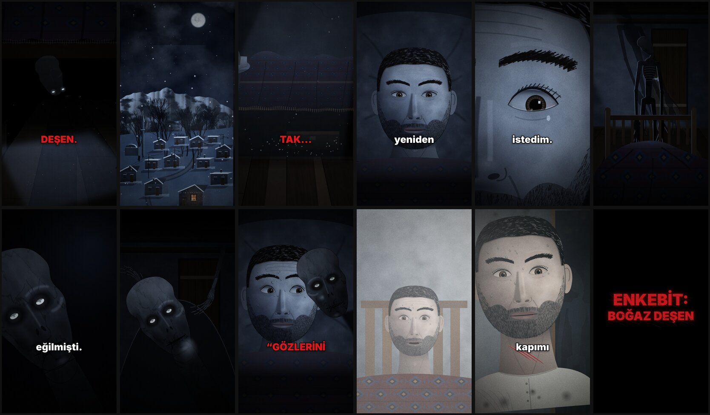

# ENKEBİT: BOĞAZ DEŞEN

Anadolu halk inanışlarından esinlenen, 120 saniyelik kurgusal bir 2D korku kısa filmi.
Instagram Reels ve TikTok için dikey 9:16 formatında hazırlandı.

| Özellik | Değer |
|---|---|
| Süre | 120,0 sn |
| Çözünürlük | 1080 × 1920 (9:16) |
| Kare hızı | 24 FPS (2880 kare) |
| Video | H.264 High, yuv420p, faststart, ~3,1 Mbit/s (2 geçişli) |
| Ses | AAC 48 kHz stereo, −14 LUFS / −1,5 dBTP |
| Altyazı | Görüntüye gömülü, kelime kelime, seslendirmeyle senkron |

Videolar:
- `out/enkebit_bogaz_desen_9x16.mp4`: ana film (120 sn)
- `out/enkebit_kapanis_15s_9x16.mp4`: kapanış bölümü ve jumpscare (15 sn)
- `out/enkebit_bogaz_desen_tam_135s_9x16.mp4`: ana film ile kapanış art arda (135 sn)



## Nasıl yapıldı

- **Görüntü:** Tüm sahneler `render/` altındaki HTML Canvas kodu ile prosedürel olarak çizilir.
  Her kare zamana göre deterministiktir; `render_frames.cjs` başsız Chromium'u (Playwright) sürer
  ve 2880 JPEG kare üretir. Hazır görsel, fotoğraf ya da yapay zekâ görseli kullanılmadı.
- **Karakterler:** Anlatıcı (`man.js`) ve Enkebit (`creature.js`) tek bir parametrik modelden çizilir;
  bu yüzden yüz, kıyafet ve vücut oranları tüm sahnelerde aynı kalır.
- **Seslendirme:** ElevenLabs `eleven_v4` modeli, "Göksel – Deep & Resonant" Türkçe ses (anlatıcı) ve
  "Hebun Tuna" sesi (yaratık). Yaratığın "Gözlerini kapatma." cümlesi pitch kaydırma, çatallı katmanlar ve
  distorsiyonla insan dışı hâle getirildi (`scripts/mix_audio.py`).
- **Altyazı zamanlaması:** Her seslendirme parçası ElevenLabs Scribe ile kelime düzeyinde zamanlandı
  (`data/words_raw.json`), ardından zaman çizelgesine yerleştirildi (`scripts/build_timeline.py`).
  Her kelime kendi başlangıcında ekrana gelir; ekranda aynı anda tek kelime vardır. Korku vurgusu taşıyan
  20 kelime kırmızı ve büyük harfle gösterilir.
- **Ses efektleri:** ElevenLabs Sound Effects v3 (tırnak kazıma, tahta vuruşları, rüzgâr, köpek uluması,
  kemik çıtırtısı, nefes, battaniye, horoz vb.). Drone müziği, kalp atışı, ters "whoosh" ve sub-bass
  vuruşu `mix_audio.py` içinde sentezlenir. Sahne 6'da müzik neredeyse tamamen kesilir.

## Sahne zaman çizelgesi

| Sahne | Aralık | İçerik |
|---|---|---|
| 1 | 00:00–00:10 | Siyah açılış, yatak altında solgun gözler, tahtayı kazıyan tırnaklar, kameraya ani dönüş |
| 2 | 00:10–00:25 | Karlı dağ köyü, sönük direk lambaları, titreyen ahşap kapı, mum ışıklı pencereye giriş |
| 3 | 00:25–00:43 | Mum söner, kamera yatak altına iner, üç tıkırtı, kazıma sesi, gözler açılır, kulakta nefes |
| 4 | 00:43–01:00 | Uyku felci: göz bebeği, titreyen parmaklar, çöken battaniye, ayak ucunda doğrulan gölge |
| 5 | 01:00–01:20 | Enkebit: ayaklar, dizlerin altına sarkan eller, yana yatık kafa, yatağa çıkış, göğse çökme |
| 6 | 01:20–01:41 | Boğaza uzanan tırnaklar, fısıltı ("Gözlerini kapatma."), görüntü kararır |
| 7 | 01:41–01:52 | Sabah ışığı, boş oda, boğaz kontrolü, aynaya yürüyüş |
| 8 | 01:52–02:00 | Aynada üç tırnak izi, arkada siluet, ani karartma, kırmızı başlık, tek kazıma sesi, sessizlik |

### Kapanış (15 sn, izleyiciye hitap + jumpscare)

| Aralık | İçerik |
|---|---|
| 0:00–0:02,7 | "Peki, siz daha önce Enkebit'i duydunuz mu?": ay ışığında boş yatak |
| 0:02,7–0:07,4 | "...karanlık odanızda onunla birebir karşılaşsaydınız… ne yapardınız?": kapı köşesinde solgun gözler açılır, siluet başını yana eğer |
| 0:07,4–0:09,5 | "Belki de şu an yalnız olduğunuzu düşünüyorsunuz.": ekranın kenarından uzun tırnaklı bir el süzülür, tırnaklar tıklar |
| 0:09,5–0:13,5 | "Ama unutmayın… Bazı efsaneler, siz gözlerinizi kapattığınızda başlar.": tavana bakan bakış, göz kapakları kapanırken tavanda tutunan yaratık görünür |
| 0:13,5–0:13,85 | Mutlak sessizlik, karanlıkta iki göz |
| 0:13,85–0:14,55 | Jumpscare: çığlık atan yüz, beyaz flaş, sarsıntı, RGB kayması, glitch yırtılmaları, darbe ve sub-bass |
| 0:14,55–0:15 | Siyah ekranda kırmızı "ENKEBİT" |

Kapanış anlatımı aynı sesle (Göksel, `eleven_v4`) üretildi. 15 saniyeye sığması için yalnızca kelime sınırlarındaki
duraklamalar kısaltıldı ve tempo ×1,07 artırıldı (`scripts/build_outro_timeline.py`). Anlatım seviyesi ana filmle eşleştirildi.

Sahne sınırları, gerçek seslendirme uzunluklarına göre birkaç yüz milisaniye kaydırıldı; toplam süre 120 sn.

## Yeniden üretme

```bash
python3 scripts/build_timeline.py                 # zaman çizelgesi + render/timeline.js
node render/render_frames.cjs frames out/frames   # 2880 kare (4 paralel sekme)
scripts/build_video.sh                            # ses miksi + loudnorm + H.264/AAC mp4
PAGE=outro.html node render/render_frames.cjs frames out/frames_outro   # kapanış kareleri (360)
scripts/build_outro.sh                            # kapanış miksi + 15 sn ve 135 sn videolar
```

Tek kare önizleme: `node render/render_frames.cjs stills /tmp/kareler 34.9 92 117.5`

Gereksinimler: Node + Playwright (Chromium), Python 3 + numpy + scipy, ffmpeg, Inter fontu.

Bu eser, Anadolu halk inanışlarından esinlenen kurgusal bir korku anlatısıdır.
